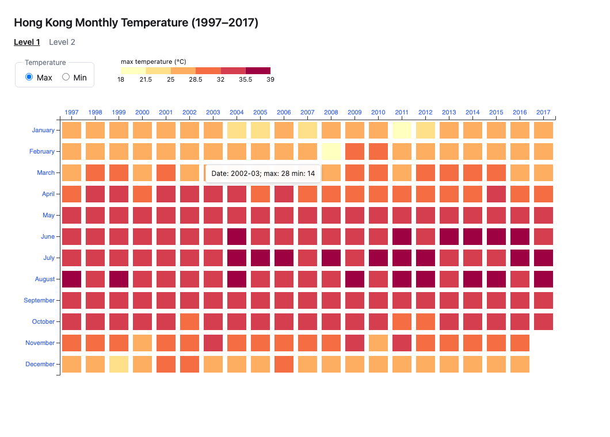
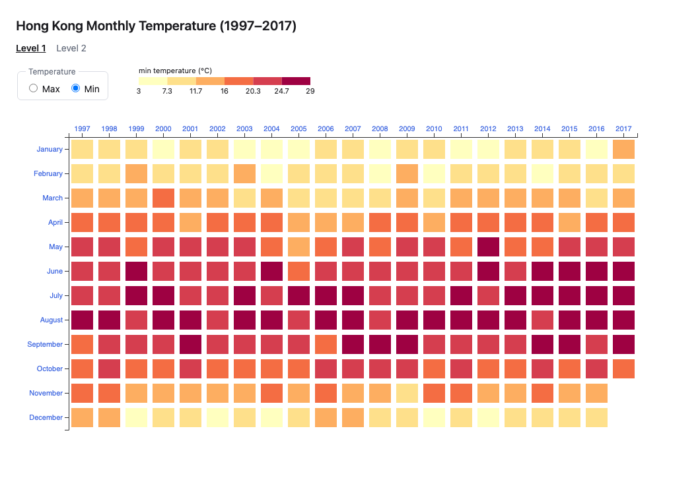
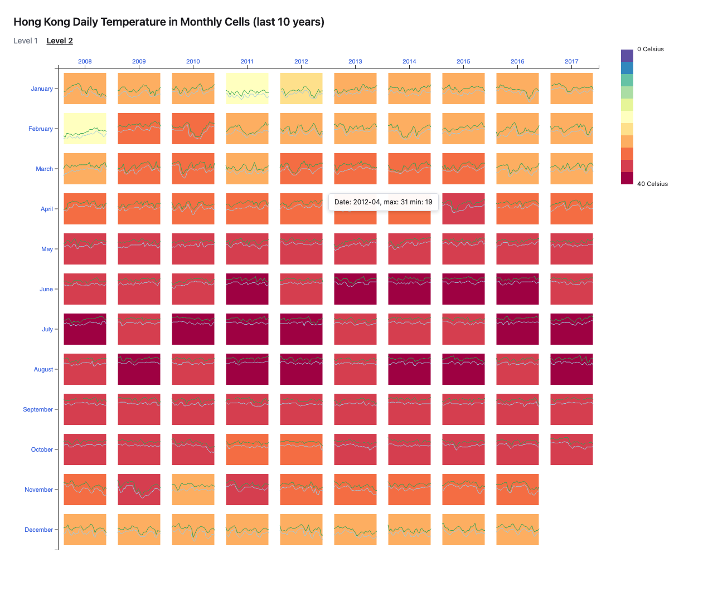

# CSCE-679-Data-Visualization-Assignment1

Hong Kong daily temperature (1997–2017), visualized as a year/month matrix with
D3.js v7. Built from [temperature_daily.csv](./temperature_daily.csv).

## Viewing the result

`d3.csv()` uses `fetch()`, which browsers block on `file://` URLs. Opening the
HTML files directly will fail with a CORS error, so serve the folder over HTTP:

```sh
git clone https://github.com/KiRyuWen/CSCE-679-Data-Visualization-Assignment1.git
cd CSCE-679-Data-Visualization-Assignment1
python3 -m http.server 8000
```

Then open:

| Page | URL |
| --- | --- |
| Level 1 — year/month heatmap | <http://localhost:8000/index.html> |
| Level 2 — heatmap with daily line charts | <http://localhost:8000/level2.html> |

(VS Code's Live Server extension works too.) No build step and no install —
D3 v7 is loaded from a CDN, so an internet connection is required on first load.

### What to try

- **Level 1:** use the **Max / Min** radio buttons to switch which temperature
  the colors encode. The legend rescales with the selection.
- **Both levels:** hover any cell for a tooltip showing the month and its
  temperature values.

## Results

### Level 1 — Max temperature, with tooltip



### Level 1 — Min temperature

Switching the metric refits the color scale, so each view uses the full
palette.



### Level 2 — Daily detail, last 10 years (2008–2017)

Each cell keeps the Level 1 background color and adds that month's daily
maximum (green) and minimum (blue) as a mini line chart.



## Project structure

```
index.html            Level 1 page
level2.html           Level 2 page
css/styles.css        All presentation; no geometry
js/
  config.js           Cell sizes, margins, color classes — all tunable values
  data.js             CSV loading; daily rows -> monthly records
  color-scale.js      The cell background color scale, shared by both levels
  heatmap.js          The year x month grid, shared by both levels
  mini-line-chart.js  Level 2: the per-cell daily line pair
  legend.js           Horizontal (Level 1) and vertical (Level 2) legends
  tooltip.js          Shared hover tooltip
  main-level1.js      Level 1 wiring
  main-level2.js      Level 2 wiring
```

`heatmap.js` draws the grid and positions one `<g>` per month, then hands each
group to a caller-supplied `renderCell` callback. Level 1 fills a rectangle;
Level 2 fills the same rectangle and adds a line chart. Both levels therefore
share one implementation of the scales, axes and data join.

## Implementation notes

**Colors are quantized, not a continuous ramp.** The reference images contain
exactly six distinct cell colors, all of them ColorBrewer *Spectral* swatches.
The implementation uses `d3.scaleQuantize` with six classes rather than a
sequential interpolator.

**The color domain runs to (data maximum + 2).** With six equal classes this
puts the breaks at 21.5 / 25 / 28.5 / 32 / 35.5 °C, which reproduces the
reference cell for cell. Using the bare `d3.extent` moves roughly 40% of the
cells into a neighbouring class.

**Level 2's mini charts share one fixed 0–40 °C scale.** Fitting each cell to
its own month would make a mild February and a hot August look identical and
defeat the purpose of the chart. The fixed domain is also what the Level 2
legend's 0–40 °C axis refers to. The legend shows all eleven Spectral classes
even though Hong Kong only ever reaches the warm six.

**One deliberate deviation.** Level 2's reference tooltip reports the *highest*
daily minimum (28 °C for 2012-04) under the label "min", while the month's
actual minimum is 19 °C — inconsistent with its own Level 1 tooltip. This
implementation reports the true minimum on both levels.

---

## Assignment brief

### Level 1 & 2 (Basic): [Link](./level1.md)

HK Temperature Heatmap


### Grading

1. Correctness (50%): The data visualizations generated should look the same.
2. Redability (30%): The code should be human-readable (i.e., the name of the variables and functions should be intuitive, and there should be enough comments).
3. Maintainability (20%): The code should be modulized and easily modified.

### Submission

Please create a github repository under your github account, and submit the URL of that repository to Canvas.
